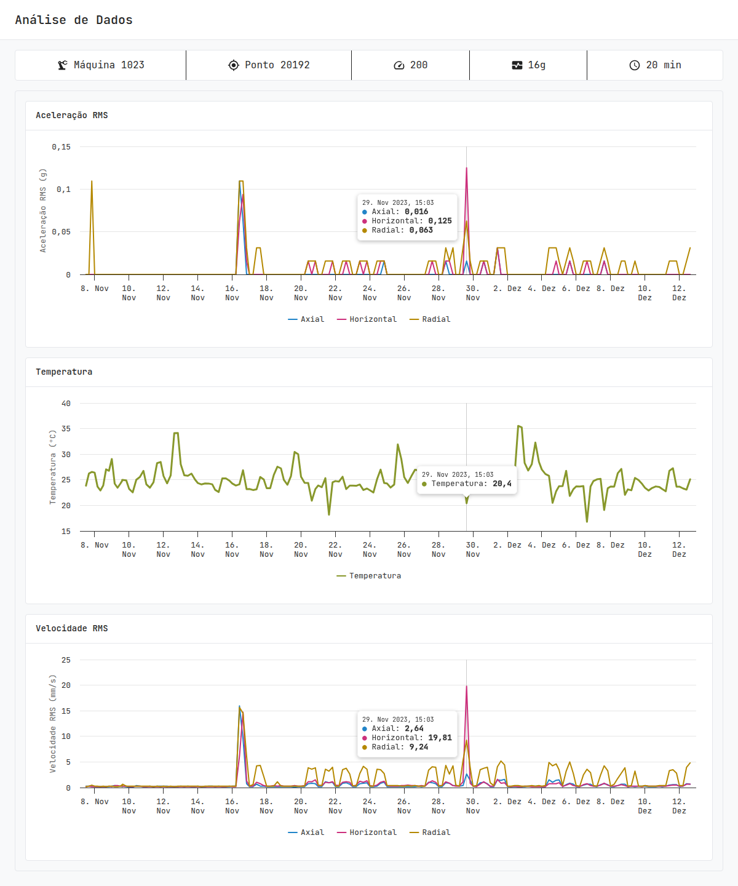

# Análise de Dados (Dynamox frontend challenge)

Dashboard for machine vibration and temperature data. It shows machine info and three time-series charts (acceleration RMS, temperature, velocity RMS). A crosshair and tooltip stay synchronized across all charts.



## Run it

Requirements:

- [Node.js](https://nodejs.org) 22.22.2+ or 24.15+ (developed on 24.21)
- [Bun](https://bun.sh) 1.1+ (the repo ships a Bun lockfile)

```sh
cd frontend
bun install
cp .env.example .env      # API base URL, defaults to http://localhost:3001
bun run api               # terminal 1: mock REST API on :3001
bun run dev               # terminal 2: app on http://localhost:5173
```

Open http://localhost:5173. The root path redirects to `/data`.

If you see "Não foi possível carregar os dados", the API is not running or `.env` is missing.

### Using the Kotlin + Spring Boot API instead

The submission also includes a real backend in `backend/`. It serves the same two endpoints on the same port, so it replaces `bun run api` without any frontend change (`VITE_API_URL` stays `http://localhost:3001`). Run one or the other, never both, because both use port 3001.

```sh
cd backend && ./gradlew bootRun    # terminal 1, instead of `bun run api` (needs JDK 25)
cd frontend && bun run dev         # terminal 2
```

See [backend/README.md](../backend/README.md).

## Scripts

| Script                    | What it does                                        |
| ------------------------- | --------------------------------------------------- |
| `bun run dev`             | Vite dev server                                     |
| `bun run api`             | Mock REST API (json-server) on port 3001            |
| `bun run build`           | Type-check and production build                     |
| `bun run preview`         | Serve the production build                          |
| `bun run test:run`        | Run unit tests once (`bun run test` for watch mode) |
| `bun run lint`            | ESLint                                              |
| `bun run e2e`             | Cypress e2e, headless (needs API and `bun run dev`) |
| `bun run e2e:open`        | Cypress e2e in the interactive runner               |
| `bun run storybook`       | Component docs on http://localhost:6006             |
| `bun run build-storybook` | Static Storybook build in `storybook-static/`       |

## Stack

| Area                   | Libraries                                                                                      |
| ---------------------- | ---------------------------------------------------------------------------------------------- |
| UI                     | React 19, MUI 5 (`@mui/material`, `@mui/icons-material`, Emotion), JetBrains Mono (Fontsource) |
| Language and build     | TypeScript 6, Vite 8                                                                           |
| State and side effects | Redux Toolkit 2, React Redux 9, Redux Saga 1                                                   |
| Routing                | React Router 7                                                                                 |
| Charts                 | Highcharts 13, `highcharts-react-official`                                                     |
| Mock API               | json-server 0.17 (default), or the Kotlin + Spring Boot API in `backend/`                      |
| Tests                  | Vitest 5, Testing Library (React, user-event, jest-dom), jsdom, `redux-saga-test-plan`         |
| E2E                    | Cypress 16                                                                                     |
| Lint                   | ESLint 10, `typescript-eslint`                                                                 |
| Docs                   | Storybook 10                                                                                   |

## API

`json-server` serves `mock/db.json`. The Spring Boot API in `backend/` serves the same contract from a copy of that file:

| Endpoint       | Returns                                                                                                              |
| -------------- | -------------------------------------------------------------------------------------------------------------------- |
| `GET /machine` | name, point, sample rate, range, interval                                                                            |
| `GET /series`  | 7 series (`accelerationRms/x`, `/y`, `/z`, `velocityRms/x`, `/y`, `/z`, `temperature`) of `{ datetime, max }` points |

The base URL comes from `VITE_API_URL`.

## Architecture

```
src/
  app/            store, root saga, theme, pages and UI components
  features/
    data/         types, slice, saga, API client, DTO to chart transform
    utils/        Highcharts options builder and chart sync
  tests/          unit tests (Vitest and Testing Library)
```

- **Data flow:** `DataPage` dispatches `fetchDataRequested` on every mount, so the data is fetched each time the route is opened. The saga calls `/machine` and `/series` in parallel and normalizes the DTOs once into Highcharts-ready `[timestamp, value]` series. The UI does no transformation on render.
- **Stale data is kept:** on a refetch or a failure, the last good data stays on screen. A thin progress bar shows a refetch. An error alert with a retry button shows a failure. An empty dataset shows an info alert.
- **Synchronized crosshair:** `features/utils/chartSync.ts` reacts to a hover on any chart and shows the tooltip and crosshair at the same timestamp on the others. It matches points by x value with a binary search and skips hidden series. It does not re-trigger events on the target charts, so there is no feedback loop.
- **Charts:** options come from one pure function (`buildChartOptions`) and are memoized per chart, so a hover does not rebuild them.
- **Responsive:** single column layout. Below 480 px chart width, charts get shorter and the left margin shrinks. The tooltip does not follow touch moves, so the page still scrolls when a finger is on a chart.

## Decisions and assumptions

- The Figma labels the velocity chart's y axis as "Aceleração (g)". I treated this as a typo and used "Velocidade RMS (mm/s)". The unit is an assumption, because the API sends no units.
- The Highcharts palette is pinned to light, so charts stay readable when the OS is in dark mode.
- Series colors were sampled from the Figma frames.
- UI text is in Portuguese. Code and docs are in English.
- `json-server` stays the default mock API, as the challenge describes. The Spring Boot backend is optional and speaks the same contract.

## Tests

```sh
bun run test:run
```

CI (GitHub Actions) runs lint, type-check, unit tests, the app build and the Storybook build on every push and pull request.

The tests cover the API client, saga, slice, DTO transform, chart options, chart sync logic, and the main components and page (loading, error, retry, stale data).

### End-to-end tests (Cypress)

`cypress/e2e/data.cy.ts` drives the real app in a browser: the redirect to `/data`, the machine info and three charts, the synchronized tooltip and crosshair, and the error and retry flow.

The suite does not start any server. Start these first, then run the tests:

```sh
bun run api      # terminal 1: API on :3001 (or the Spring Boot API in ../backend)
bun run dev      # terminal 2: app on :5173
bun run e2e      # terminal 3: headless run (`bun run e2e:open` for the interactive runner)
```

- The Cypress binary is a separate download. If `cypress run` says it is not installed, run `bunx cypress install` once.
- CI does not run e2e. It installs without the Cypress binary and starts no servers, so a green CI run covers lint, types, unit tests and builds only.
- The tests assert values from the seed data ("Máquina 1023", "Ponto 20192"). They pass with either `bun run api` or the Spring Boot API, because both serve the same data.
- The base URL is `http://localhost:5173`. Vite is pinned to that port (`strictPort`), so it fails with an error if the port is busy. Free the port and start it again.
